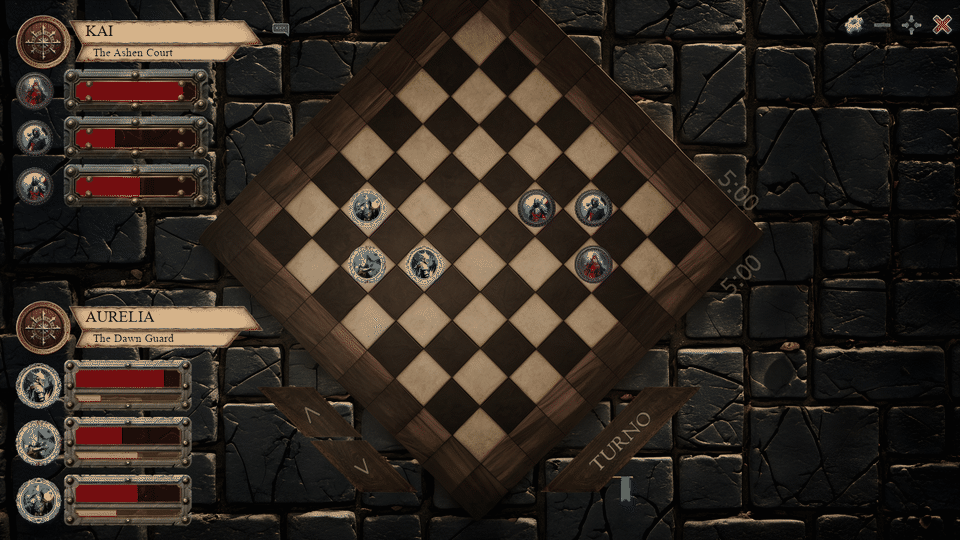

# Tria Solum

**Un duelo táctico por turnos para Windows.** Elige tres unidades, muévelas por el tablero y derrota al equipo rival.



La animación muestra una partida de demostración preparada localmente para enseñar el movimiento y las partículas. No es una sesión multijugador en vivo.

## Cómo se juega

- Cada jugador elige y coloca una formación de tres unidades entre **Magos**, **Arqueros** y **Caballeros**.
- Arrastra una unidad a una casilla libre para moverla. Los movimientos consumen maná.
- Selecciona una unidad propia y haz clic en una rival para atacarla.
- Pulsa **Turno** para pasar la jugada. Gana quien elimina todas las unidades rivales.

## Ejecutarlo en Windows

Necesitas Python 3. Desde la carpeta del proyecto, instala las dependencias y lanza el juego:

```powershell
py -m pip install pygame-ce pygame_gui numpy opencv-python pyperclip pyautogui PyQt5 pywin32 requests
py main.pyw
```

## Jugar en línea

1. Una persona elige **Crear** y pulsa **Generar**. Comparte la clave que aparece.
2. La otra elige **Unirse**, introduce la clave y pulsa **Conectar**.
3. Cuando ambos estén en la partida, pulsen **Ingresar**, elijan sus unidades y empiecen a jugar.

El anfitrión necesita poder recibir conexiones TCP en el puerto **8050**. El juego intenta configurar el firewall y UPnP; según el router, puede hacer falta permitir o redirigir ese puerto manualmente. La comunicación usa sockets TCP sin cifrado ni autenticación: comparte la clave solo con la otra persona.

## Nota sobre la demo y la IA

La vista animada se capturó desde la interfaz y los recursos del juego, con un estado de partida preparado localmente; no añade un modo sin conexión al juego. El README y la captura se prepararon con asistencia de IA. **No se modificó el código del juego.**
